# Event-Driven RPA Error Alert & Triage Pipeline

> A portfolio case study on turning automation failures into actionable, trackable work.
>
> This write-up focuses on the problem-solving approach and business value. Organization-specific names, configurations, records, and measurements are omitted; examples are illustrative and use fictional data. It is not an exact production design or an endorsement by any employer.

## Contents

- [Executive Summary](#executive-summary)
- [Business Problem and Value](#business-problem-and-value)
- [From Business Need to Technical Design](#from-business-need-to-technical-design)
- [Before and After](#before-and-after)
  - [As-Is — fragmented incident handling](#as-is--fragmented-incident-handling)
  - [To-Be — coordinated incident lifecycle](#to-be--coordinated-incident-lifecycle)
  - [Illustrative ownership map](#illustrative-ownership-map)
  - [Illustrative incident record](#illustrative-incident-record)
  - [Notification and triage example](#notification-and-triage-example)
- [My Role and Technical Approach](#my-role-and-technical-approach)
- [Evidence, Limitations, and Privacy](#evidence-limitations-and-privacy)

## Executive Summary

An automation failure creates more than a technical interruption. If an alert does not make clear who should act, where to begin, or how to preserve the resolution, the team spends extra effort coordinating instead of investigating—and useful fixes can be difficult to find again.

I designed and implemented an event-driven alert and follow-up workflow to connect a failure signal with an accountable owner, provide a practical starting point for investigation, and keep the eventual outcome in a structured history. Optional diagnostic assistance can suggest initial areas to inspect, with a human responsible for verification and action.

The central outcome is a shift from **“a failure notification was sent”** to **“the right person can understand the next step, investigate, and leave a useful record for the next incident.”**

## Business Problem and Value

The project addressed three connected operational frictions:

- **Ownership ambiguity:** a failure alert does not automatically tell people who is expected to respond.
- **Slow investigation handoff:** relevant context and the next step may not be presented together.
- **Lost operational learning:** follow-up and resolutions can be scattered, making recurring issues and handoffs harder to manage.

The workflow links these needs to practical outcomes:

| Business need | Design response | Intended value |
|---|---|---|
| Make responsibility clear | Associate an event category with an accountable role or support owner. | Less time spent figuring out who should take the next action. |
| Make alerts actionable | Include a concise event summary and a route to authorized investigation details. | A clearer transition from detection to investigation. |
| Preserve what was learned | Keep status and resolution in a searchable follow-up record. | Easier handoffs and a better chance of reusing prior troubleshooting. |
| Support early investigation | Offer optional diagnostic clues for human review. | A useful starting point without treating AI output as a confirmed diagnosis. |

These are workflow-level benefits, not claims of a measured percentage improvement.

## From Business Need to Technical Design

The design treats incident handling as a complete workflow rather than a message-sending task:

1. **Detect:** receive a failure event.
2. **Route:** identify the responsible owner from a generalized ownership reference.
3. **Contextualize:** send a concise notification with an authorized route to details.
4. **Track:** capture investigation status and resolution in a structured record.
5. **Learn:** make prior outcomes easier to review during future troubleshooting and handoffs.

This framing connects technical components to the operating need: ownership, a clear next action, and continuity of knowledge. The public diagram and examples intentionally do not specify production systems, detailed routing rules, or access configurations.

## Before and After

The diagrams compare a common fragmented pattern with the coordinated workflow this project was designed to support. They are generalized illustrations, not exact maps of an organization's procedures or systems.

### As-Is — fragmented incident handling

A failure can trigger several disconnected steps: an alert is received, the responsible person must be identified, investigation begins with available context, and status is later gathered from separate updates.

```mermaid
flowchart LR
  FAIL[Automation failure] --> ALERT[General alert channel may be delayed]
  ALERT --> FIND[Determine who should respond]
  FIND --> INVESTIGATE[Investigate with available context]
  INVESTIGATE --> UPDATES[Updates and resolution recorded separately]
  UPDATES --> STATUS[Status gathered for review]

  classDef event fill:#F3F4F6,stroke:#6B7280,stroke-width:2px,color:#222
  classDef delay fill:#FEF2F2,stroke:#DC2626,stroke-width:2px,color:#222
  classDef manual fill:#FFF7E8,stroke:#D97706,stroke-width:2px,color:#222
  class FAIL event
  class ALERT delay
  class FIND,INVESTIGATE,UPDATES,STATUS manual
```

*Color key: event = gray · delay risk = red · manual coordination = amber.*

### To-Be — coordinated incident lifecycle

The target pattern connects detection to ownership, investigation, follow-up, and future learning:

```mermaid
flowchart TD
  EVENT[Failure event] --> ROUTE[Identify responsible owner]
  ROUTE --> NOTIFY[Send actionable notification]
  ROUTE --> RECORD[Create or update follow-up record]
  NOTIFY --> REVIEW[Human investigation]
  RECORD --> REVIEW
  ASSIST[Optional diagnostic assistance] -. initial context .-> REVIEW
  REVIEW --> OUTCOME[Record disposition and resolution]
  OUTCOME --> HISTORY[Maintain searchable history]
  HISTORY --> LEARN[Inform future support and review]

  classDef coordination fill:#EFF6FF,stroke:#2563EB,stroke-width:2px,color:#222
  classDef people fill:#FFF7E8,stroke:#D97706,stroke-width:2px,color:#222
  classDef records fill:#ECFDF5,stroke:#059669,stroke-width:2px,color:#222
  classDef ai fill:#F5F3FF,stroke:#7C3AED,stroke-width:2px,color:#222
  class EVENT,ROUTE,NOTIFY coordination
  class REVIEW,LEARN people
  class RECORD,OUTCOME,HISTORY records
  class ASSIST ai
```

*Color key: routing and notification = blue · human review and learning = amber · follow-up records = green · optional AI assistance = purple.*

The expected value is a more direct handoff, clearer accountability, and a reusable record of operational knowledge. The example shows intended workflow behavior, not a measured before-and-after result.

### Illustrative ownership map

The first supporting view answers a basic operational question: **who is responsible for this kind of event?** This fictional example demonstrates the concept only and does not show real ownership assignments.

| Workflow category *(fictional)* | Responsible role *(fictional)* | Backup reviewer *(fictional)* |
|---|---|---|
| Billing review demo | Operations owner A | Support reviewer B |
| Catalog validation demo | Operations owner C | Support reviewer D |

A generalized ownership reference can help direct an event to the right role. The actual source, naming convention, and routing rules are not included.

### Illustrative incident record

The second view demonstrates how an investigation and its outcome can stay together. All values below are fabricated for this portfolio example.

| Event time *(fictional)* | Category *(fictional)* | Status | Sanitized issue summary | Priority | Example follow-up | Response time *(fictional)* |
|---|---|---|---|---|---|---|
| 2026-01-15 09:00 | Billing review demo | Needs review | A required page element was unavailable at a workflow step. | Medium | Added a readiness check before continuing. | 2026-01-15 09:20 |

A structured record can make prior outcomes easier to search and can support handoffs. The example does not represent a real incident, response target, or company metric.

### Notification and triage example

A useful alert should make the next action clear without exposing unnecessary detail. The sample below uses fictional placeholders and no live links.

> **Automation event requires review**  
> Event time: `[fictional timestamp]`  
> Category: `[fictional workflow category]`  
> Summary: `[sanitized event summary]`  
> Next step: **Open authorized follow-up** · **View event details**

Optional diagnostic assistance may offer an initial clue—for example, checking whether a page or required element was ready before a workflow step. A qualified person verifies the evidence and decides what to do. The workflow does not imply autonomous diagnosis or remediation.

## My Role and Technical Approach

### My role

- Connected an operational pain point—failure alerts that did not reliably provide ownership and follow-up—with concrete workflow requirements.
- Designed and implemented the event-to-owner-to-investigation flow, including actionable notifications and structured tracking.
- Refined the workflow around usability and review needs, translating feedback into practical changes.
- Added optional AI-assisted triage as a human-reviewed investigation aid, not an automated decision-maker.

### Technical approach

The implementation used an event/webhook pattern, API integration, lightweight cloud scripting, structured records, collaboration notifications, and optional language-model-assisted analysis. Specific vendors, internal component names, deployment details, and configuration are omitted from this public overview.

## Evidence, Limitations, and Privacy

- This case study demonstrates the problem framing, workflow design, and example artifacts; it does not publish quantitative performance results, adoption figures, or company KPIs.
- The tables and notification are fictional illustrations. They are included to make the workflow tangible, not to reproduce a production workbook or message.
- The public description omits employer and customer identifiers, internal URLs, credentials, real records, incident payloads, detailed routing rules, and company-specific measurements.
- AI-assisted output is advisory and requires human verification; technical signals may not contain the full business context.
- This abstraction does not establish publication authorization. Review applicable employment agreements, confidentiality and intellectual-property obligations, and employer publication policies before sharing; obtain approval where required.
